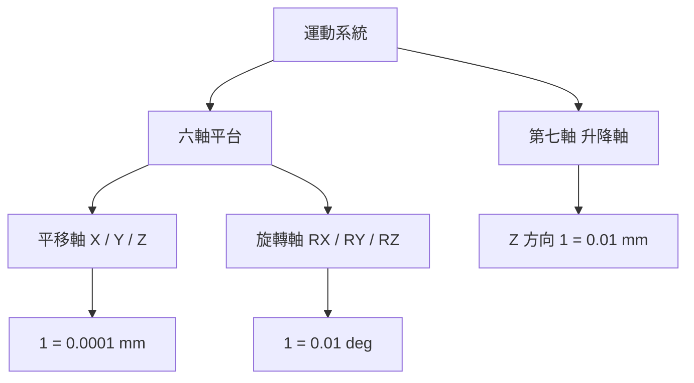
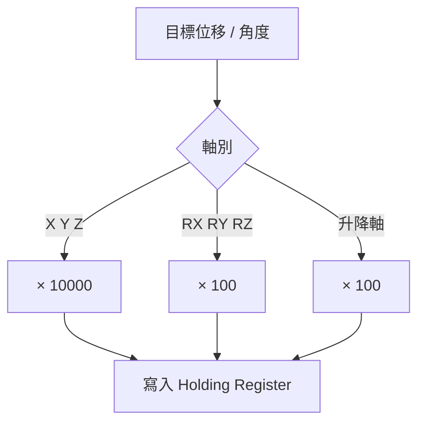
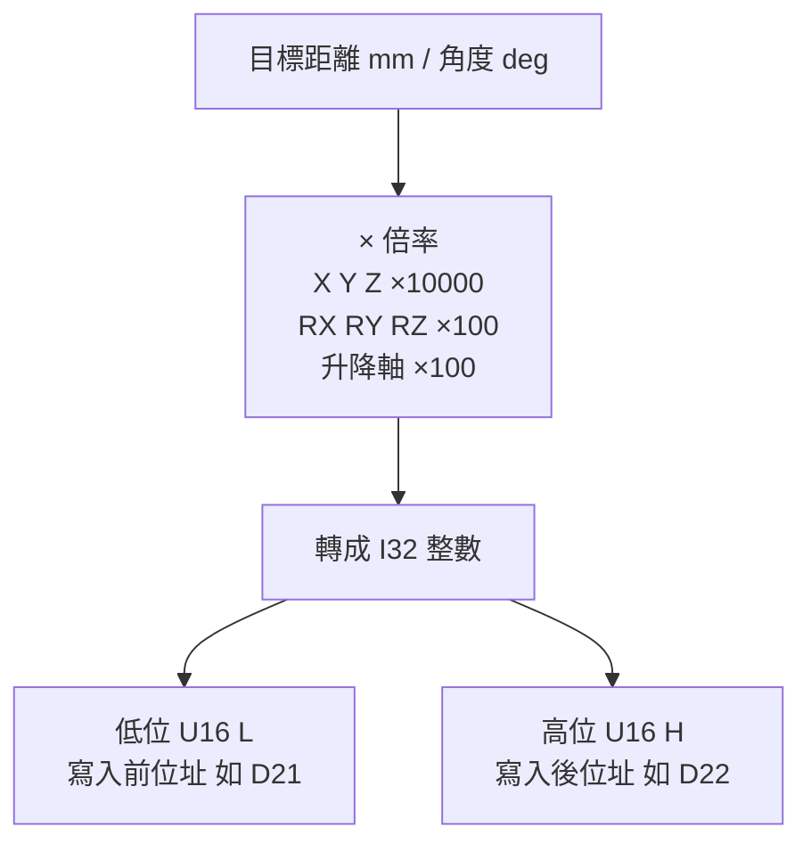
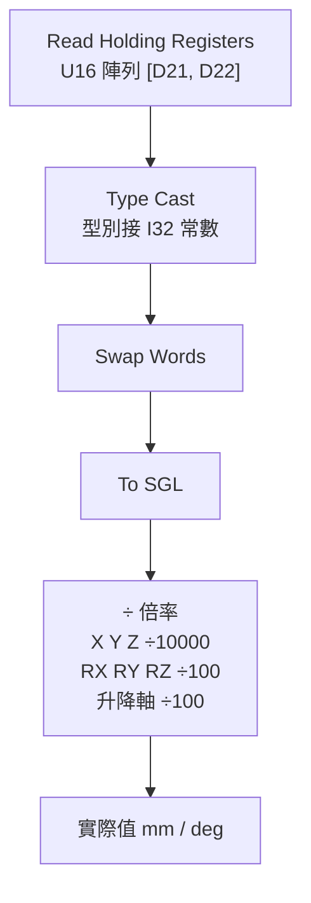
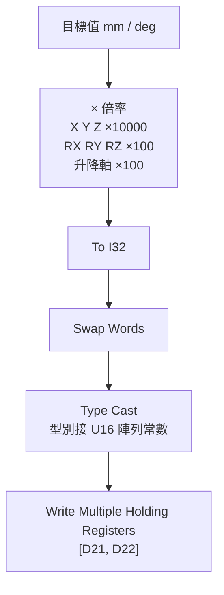

# 六軸平台＋第七軸升降軸 單位換算說明

本文件說明六軸平台與第七軸升降軸在 Modbus Holding Register 上的數值與實際位移量的對應關係。

## 軸系組成

## 各軸解析度對照

| 軸別 | 軸名 | 運動類型 | 方向 | 單位 | Register = 1 代表 |
|------|------|----------|------|------|-------------------|
| 六軸平台 | X  | 平移（距離） | X 方向 | mm  | 0.0001 mm |
| 六軸平台 | Y  | 平移（距離） | Y 方向 | mm  | 0.0001 mm |
| 六軸平台 | Z  | 平移（距離） | Z 方向 | mm  | 0.0001 mm |
| 六軸平台 | RX | 旋轉（角度） | 繞 X 軸 | deg | 0.01 deg |
| 六軸平台 | RY | 旋轉（角度） | 繞 Y 軸 | deg | 0.01 deg |
| 六軸平台 | RZ | 旋轉（角度） | 繞 Z 軸 | deg | 0.01 deg |
| 第七軸 | 升降軸 | 平移（距離） | Z 方向 | mm | 0.01 mm |

## 換算公式

| 軸別 | 實際值 → Register | Register → 實際值 |
|------|-------------------|-------------------|
| X、Y、Z | Register = 距離(mm) × 10000 | 距離(mm) = Register × 0.0001 |
| RX、RY、RZ | Register = 角度(deg) × 100 | 角度(deg) = Register × 0.01 |
| 第七軸升降軸 | Register = 距離(mm) × 100 | 距離(mm) = Register × 0.01 |

## 換算範例

| 軸別 | 目標值 | 計算 | Register 寫入值 |
|------|--------|------|-----------------|
| X  | 1 mm      | 1 × 10000      | 10000 |
| Y  | 0.5 mm    | 0.5 × 10000    | 5000 |
| Z  | -2.3456 mm | -2.3456 × 10000 | -23456 |
| RX | 1 deg     | 1 × 100        | 100 |
| RZ | -0.25 deg | -0.25 × 100    | -25 |
| 升降軸 | 10 mm | 10 × 100       | 1000 |
| 升降軸 | 150.25 mm | 150.25 × 100 | 15025 |

## 注意事項

> [!IMPORTANT]
> 平移軸與升降軸雖然都是距離，但解析度相差 100 倍：
> - 六軸平台 X / Y / Z：1 = 0.0001 mm
> - 第七軸升降軸：1 = 0.01 mm
>
> 寫入前務必確認目標軸別，避免位移量差 100 倍。

## 資料格式：2 × U16 → I32

所有軸（X、Y、Z、RX、RY、RZ、升降軸）的數值都由兩個 U16 Holding Register 組成一個 I32（32 位元有號整數，負數以二補數表示）。I32 的數值就是上表的 Register 值，例如 X 軸 1 mm 存成整數 10000，Z 軸 -2.3456 mm 存成整數 -23456。

| U16 | 對應 I32 位元 |
|-----|---------------|
| 低位 L | bit 15 ~ 0 |
| 高位 H | bit 31 ~ 16（bit 31 為符號位元） |

> [!IMPORTANT]
> 距離與角度都可能是負值，PLC 與 LabVIEW 兩端都必須用有號的 I32，不能用 U32。用 U32 時：
> - 讀取：PLC 存 -1000，LabVIEW 會讀成 4294966296。
> - 寫入：負的 SGL 經過 To U32 會被 LabVIEW 夾成 0，往負方向的目標位置變成 0，而且不會報錯。

### I32 拆分範例

| 軸別 | 目標值 | I32 值 | I32 十六進位 | 前位址 Low (L) | 後位址 High (H) |
|------|--------|--------|--------------|----------------|-----------------|
| X  | 1 mm        | 10000  | 0x00002710 | 0x2710（10000） | 0x0000（0） |
| Y  | 0.5 mm      | 5000   | 0x00001388 | 0x1388（5000） | 0x0000（0） |
| Z  | -2.3456 mm  | -23456 | 0xFFFFA460 | 0xA460（42080） | 0xFFFF（65535） |
| RX | 1 deg       | 100    | 0x00000064 | 0x0064（100） | 0x0000（0） |
| RZ | -0.25 deg   | -25    | 0xFFFFFFE7 | 0xFFE7（65511） | 0xFFFF（65535） |
| 升降軸 | 10 mm     | 1000   | 0x000003E8 | 0x03E8（1000） | 0x0000（0） |
| 升降軸 | 150.25 mm | 15025  | 0x00003AB1 | 0x3AB1（15025） | 0x0000（0） |

負值的高位一律是 0xFFFF（65535）附近，在 Modbus 監控軟體上看到 D22 = 65535 不是異常，而是負數。

### Word Order：前 Low、後 High

連續兩個位址中，前一個位址放低位 L，後一個位址放高位 H。

| 位址 | 內容 | 以 X = 1 mm（0x00002710）為例 | 以 Z = -2.3456 mm（0xFFFFA460）為例 |
|------|------|-------------------------------|--------------------------------------|
| D21（前） | 低位 U16 (L)，bit 15 ~ 0 | 0x2710（10000） | 0xA460（42080） |
| D22（後） | 高位 U16 (H)，bit 31 ~ 16 | 0x0000（0） | 0xFFFF（65535） |

> [!IMPORTANT]
> 順序反了數值會完全錯誤。例如 X = 1 mm 把 0x0000 寫進 D21、0x2710 寫進 D22，PLC 會讀成 0x27100000 = 655360000，而不是 10000。

## LabVIEW 接法

Type Cast 只重新解讀位元、不換算數值；To SGL、To I32 才是數值轉換。PLC 端存的是 I32 整數，所以 Type Cast 的型別接 I32，之後再用 To SGL 轉成浮點數計算。

### 讀取（PLC → PC）

| 步驟 | LabVIEW 函式 | 輸入 | 輸出 |
|------|--------------|------|------|
| 1 | Modbus Read Holding Registers | 起始位址 D21、數量 2 | U16 陣列 [D21, D22] |
| 2 | Type Cast | U16 陣列，type 接 I32 常數 | I32（高低位仍顛倒） |
| 3 | Swap Words | I32 | I32（高低位修正） |
| 4 | To Single Precision Float | I32 | SGL |
| 5 | Divide | SGL ÷ 倍率 | 實際值（mm / deg） |

Type Cast 是 big-endian，會把陣列第一個元素 D21 當成高位，所以第 2 步得到的是 0x2710_0000 這種高低位顛倒的值，第 3 步 Swap Words 再把兩個字對調回來。

### 寫入（PC → PLC）

| 步驟 | LabVIEW 函式 | 輸入 | 輸出 |
|------|--------------|------|------|
| 1 | Multiply | 目標值 × 倍率 | SGL（Register 單位） |
| 2 | To Long Integer | SGL | I32（四捨五入到整數） |
| 3 | Swap Words | I32 | I32（低位移到前面） |
| 4 | Type Cast | I32，type 接 U16 陣列常數 | U16 陣列 [L, H] |
| 5 | Modbus Write Multiple Holding Registers | 起始位址 D21、U16 陣列 | 寫入 D21 = L、D22 = H |

### 容易踩錯的地方

| 錯誤做法 | 結果 | 正確做法 |
|----------|------|----------|
| Type Cast 的型別接 U32 | 負值讀成四十幾億，例如 -1000 讀成 4294966296 | 型別接 I32 常數 |
| 寫入用 To U32 | 負的目標值被夾成 0，不會報錯 | 改用 To I32 |
| 漏接 Swap Words | 高低位顛倒，X = 1 mm 讀成 655360000 | Type Cast 之後（讀取）、Type Cast 之前（寫入）都要接 Swap Words |
| U16 陣列直接 Type Cast 成 SGL | 整數的位元被當成浮點數，X = 1 mm 讀成約 2.0×10⁻¹⁵ | Type Cast 接 I32，再用 To SGL 做數值轉換 |
| 乘完倍率直接 Type Cast，沒有先 To I32 | SGL 的位元被送到 PLC，PLC 讀到的整數完全錯誤 | 先 To I32，再 Swap Words、Type Cast |

## 各軸可移動範圍（資料格式上限）

I32 的範圍是 -2,147,483,648 ~ +2,147,483,647，乘上各軸解析度：

| 軸別 | 解析度 | I32 範圍換算（負 ~ 正） |
|------|--------|-------------------------|
| X  | 0.0001 mm | -214748.3648 mm ~ +214748.3647 mm |
| Y  | 0.0001 mm | -214748.3648 mm ~ +214748.3647 mm |
| Z  | 0.0001 mm | -214748.3648 mm ~ +214748.3647 mm |
| RX | 0.01 deg  | -21474836.48 deg ~ +21474836.47 deg |
| RY | 0.01 deg  | -21474836.48 deg ~ +21474836.47 deg |
| RZ | 0.01 deg  | -21474836.48 deg ~ +21474836.47 deg |
| 升降軸 | 0.01 mm | -21474836.48 mm ~ +21474836.47 mm |

> [!NOTE]
> LabVIEW 端用 SGL 計算時，SGL 只能精確表示 ±16,777,216 以內的整數，超過會有捨入誤差（例如 16,777,217 變成 16,777,216）。換算成 X/Y/Z 約 ±1677.7216 mm、角度與升降軸約 ±167772.16。實際行程若可能超過，計算改用 DBL。

> [!WARNING]
> 上表只是資料格式的上限，不是機構行程。實際可移動範圍受機構與正負極限開關限制，遠小於上表，請依設備規格書填寫：
>
> | 軸別 | 機構行程（負 ~ 正） |
> |------|---------------------|
> | X  | 待確認 |
> | Y  | 待確認 |
> | Z  | 待確認 |
> | RX | 待確認 |
> | RY | 待確認 |
> | RZ | 待確認 |
> | 升降軸 | 待確認 |
