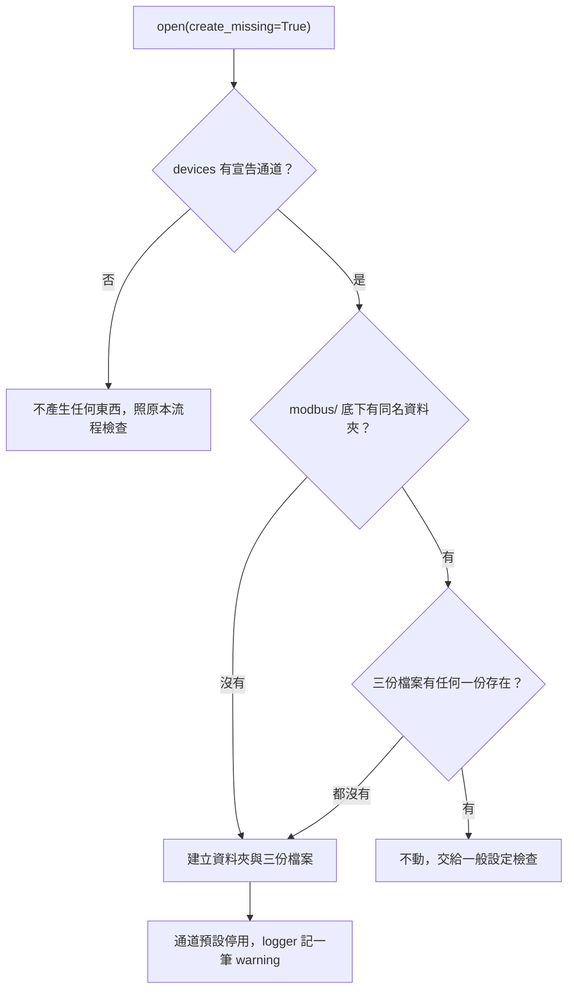
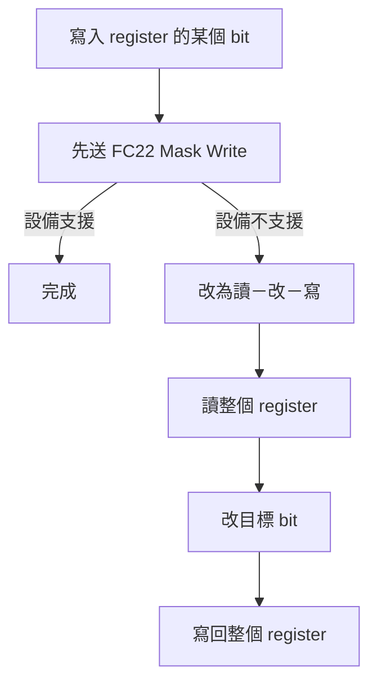

# modbus_tags

Modbus TCP／RTU Master 基底函式庫。這個資料夾就是複製到各專案的完整單位。

## 複製到專案

1. 把整個 `modbus_tags/` 資料夾複製到專案裡，`CHANGELOG.md` 與本檔一起帶走。
2. 專案加相依：

   ```
   uv add "pymodbus[serial]>=3.16.2,<3.17"
   ```

3. 建立設定資料夾 `config/modbus/Channel01/`，放 `device.toml`、`io_points.csv`（`read_ranges.toml` 可省略）。

| 需求 | 版本 |
|---|---|
| Python | 3.14 以上 |
| pymodbus（含 serial extra，RTU 用 pyserial） | >=3.16.2,<3.17 |

> [!WARNING]
> 模擬設備依賴 pymodbus 3.16 未公開文件的 request handler 介面，所以版本限定在 3.16.x。要升級 pymodbus 時，先在基底 project 放寬範圍並跑完全部測試，確認通過再更新副本。

> [!NOTE]
> 資料夾可以放在專案的任何層級（例如 `app/lib/modbus_tags/`）；套件內部只用相對 import，位置不影響運作。

> [!TIP]
> `io_points.csv` 接受 UTF-8（有無 BOM 皆可）與 Big5。要用 Excel 開的檔案不要用沒有 BOM 的 UTF-8，Excel 會把中文顯示成亂碼。

## 基本用法

```python
import modbus_tags

# 開發者名稱 -> 通道資料夾；名稱只寫在程式碼，不寫進設定檔
DEVICES = {"PLC_A": "Channel01", "TempCtrl": "Channel03"}

with modbus_tags.open("config", devices=DEVICES) as bus:   # 進入 start()，離開 stop()
    snap = bus.snapshot("PLC_A")           # 最近一輪的結果；沒讀過為 None
    if bus.status("PLC_A") is modbus_tags.DeviceStatus.CONNECTED:
        print(bus.read("PLC_A/Speed"))     # 參照格式「設備/Tag 名稱」；不通訊、不等待
        ticket = bus.write("PLC_A/Speed", 120)   # 排進佇列後立刻返回
        ticket.wait(timeout=3)             # 失敗拋 WriteFailed，逾時拋 WaitTimeout
        bus.write_wait("TempCtrl/Zone1 SV", 80.5, timeout=3)
```

| 概念 | 說明 |
|---|---|
| `open(config_dir, devices=None, simulate=False, *, create_missing=False)` | 讀取並檢查設定，不通訊；設定有誤拋 `ConfigError`，列出所有問題；`create_missing` 見下一節 |
| `devices` 對照 | 沒列入的通道以資料夾名稱識別（例如 `Channel02`） |
| `start()` / `stop()` | 啟動、停止全部通道；連不上的設備不會讓 `start()` 拋錯，狀態會在 `CONNECTING`、`CONNECTED`、`RECONNECTING`、`DISCONNECTED` 間轉換 |
| `read(ref)` / `snapshot(device)` | 讀最近一輪的值；設備未連線時 `read` 拋 `DeviceDisconnected` |
| `write(ref, value)` / `write_wait(...)` | 寫入工程值；唯讀、超出範圍、未連線在呼叫當下拋錯，設備端的結果看 `Ticket`。會立刻喚醒通道：等待中或一輪結束時有寫入，就立刻開始新的一輪（先寫入再讀取），不等下一個輪詢週期 |
| `devices()` / `tags(device)` / `status(device)` | 查詢設備、Tag 與連線狀態 |
| `stats(device)` | 回傳 `PollStats`：`last_ms`、`average_ms`、`max_ms` 是連線後每輪讀取的耗時，未連線時為 `None`，重新連線後從頭計算；`requests`、`interval_ms` 是每輪讀取請求數與輪詢週期。不通訊、不等待 |
| `on_change` / `on_status` / `on_write_done` | 註冊事件函式，回傳取消函式 |

### 模擬設備

沒有實機時，用同一份設定跑內建模擬設備：

```python
with modbus_tags.open("config", devices=DEVICES, simulate=True) as bus:
    bus.simulator.set("PLC_A/Speed", 100)     # 模擬設備端改值
    bus.simulator.get("PLC_A/Speed")
```

- `simulate=True` 時，設定檔裡的 host、port、COM port 都不使用，Bus 直接連到模擬 server；`bus.stop()` 一併關閉模擬 server。
- 也可單獨用 `modbus_tags.Simulator(config, devices)`，`start()` 後以 `sim.address(設備名稱)` 取得位址。
- `Simulator` 另有 `set_online`、`reject_function`、`set_delay`、`requests` 供測試注入故障與檢查請求。

### 缺少的通道自動產生預設設定

`create_missing=True` 讓 `open()` 為 `devices` 宣告、但還沒建立設定的通道產生預設檔案，現場不必手寫第一份設定。

```python
with modbus_tags.open("config", devices=DEVICES, create_missing=True) as bus:
    ...
```



三份檔案是 `device.toml`、`io_points.csv`、`read_ranges.toml`。資料夾存在但沒有這三份檔案（空的，或只有 `notes.txt` 之類的無關檔案）時，只補這三份，無關檔案不動。

| 資料夾內已有的檔案 | `enabled` | 結果 |
|---|---|---|
| `device.toml`、`io_points.csv` | true | 成功，不產生 `read_ranges.toml` |
| 三份都有 | true | 成功 |
| 只有 `device.toml` | false | 成功，通道停用 |
| 只有 `device.toml` | true | `ConfigError`，指出缺 `io_points.csv` |
| `device.toml`、`read_ranges.toml` | true | `ConfigError`，指出缺 `io_points.csv` |
| 只有 `io_points.csv`、只有 `read_ranges.toml`、或兩者並存 | 任意 | `ConfigError`，指出缺 `device.toml` |

新通道的處理：

- 預設停用：`device.toml` 只有 `enabled = false`，`open()` 成功，但 `bus.status()`、`bus.read()` 該通道拋 `DeviceDisabled`，`bus.devices()` 不列出它。
- 啟用方式：照 `device.toml` 內的說明，選 TCP 或 RTU 其中一種取消註解、填入連線資料，再把 `enabled` 改成 `true`。
- 範例點位：`io_points.csv` 有 4 個 `Example` 開頭的唯讀點位，位址是範例值。

> [!WARNING]
> 範例點位的位址在實機上可能不存在，會被判定斷線。連實機前，先把 `io_points.csv` 的範例列改成實際點位。

> [!IMPORTANT]
> 改了 `io_points.csv` 的點位，要同步 `read_ranges.toml` 的範圍，否則 `open()` 會報 `is not covered by any range`。不想維護範圍時，刪除 `read_ranges.toml` 改用自動分組；刪除後，`create_missing=True` 不會再把它產生回來。

> [!CAUTION]
> 開著 `create_missing` 時，`devices` 裡拼錯名稱，或有人誤刪通道資料夾，都不會在啟動時報錯，而是安靜地產生一個停用的新通道，只留下一筆 warning。正式出貨建議關閉（預設即關閉），只在第一次佈署或開發時開啟。

其他規則：

- 沒開 `create_missing` 時，行為與 0.2.0 相同，不寫任何檔案。
- 寫檔過程發生錯誤時，這次建立的檔案與資料夾會全部移除，拋 `ConfigError`；原本就存在的東西不動。
- 新資料夾名稱只能用英數與底線，且不可是 Windows 保留名稱（`CON`、`NUL` 等）。
- `Simulator(config, devices)` 不會產生任何檔案。

## 使用上的限制

### 設備名稱與資料夾名稱

| 名稱 | 來源 | 可否由現場修改 |
|---|---|---|
| 開發者名稱（`PLC_A`） | 程式碼的 `open(devices=...)` | 否，改程式碼 |
| `display_name`（`左側 PLC`） | `device.toml` | 可以，現場隨時改，只影響顯示與訊息 |
| 通道資料夾名稱（`Channel01`） | 資料夾 | 不可改：`devices` 對照靠它找設備 |

> [!IMPORTANT]
> 現場只改資料夾內的檔案，不要重新命名資料夾。資料夾名稱只用英數與底線。

### 32 位元順序與單次讀取上限

| 情況 | 做法 |
|---|---|
| 設備的 32 位元點是高位在前 | 在該點的 Attributes 寫 `word_order=high_first`；沒寫就是 `low_first` |
| 設備單次能讀的數量小於 Modbus 標準（register 125、bit 2000） | 在 `read_ranges.toml` 把範圍切短 |

> [!WARNING]
> 沒有 `read_ranges.toml` 時，自動分組會把連續位址合併到標準上限。上限較小的設備若沒寫這個檔，可能收到過大的請求、回例外碼，然後被判定斷線。

### register bit 的寫入



> [!WARNING]
> 讀－改－寫在「讀」與「寫」之間，若設備自己改了同一個 register 的其他 bit，設備的修改會被蓋掉。同一通道的請求依序送出，自己程式的寫入不會互蓋；風險只來自設備本身。設備支援 FC22 時不受影響。

### 事件函式

事件函式在通道 thread 上執行。

> [!CAUTION]
> - 要短：耗時工作會拖慢該通道的輪詢。
> - 不可呼叫 `write_wait()` 或 `ticket.wait()`：通道 thread 等自己會 deadlock，這兩個函式在通道 thread 上會直接拋 `RuntimeError`。
> - Qt 應用程式只在事件函式裡 emit signal，並接到 QObject 的 slot；接 lambda 會是 direct connection，仍在通道 thread 執行。

| 事件 | 函式簽名 |
|---|---|
| `bus.on_change(func)` | `func(device, changed, snapshot)` |
| `bus.on_status(func)` | `func(device, status, reason)` |
| `bus.on_write_done(func)` | `func(ticket)` |

### 連線判定與 RTU 共線

- 判定逾時時間：TCP 為 `timeout_ms × (retries + 1)`，RTU 為 `timeout_ms × (2 × retries + 1)`。
- 一次讀取在這段時間內都沒有有效回應，就判定該通道斷線，並依 `auto_reconnect` 進入 `RECONNECTING`。

> [!WARNING]
> 同一條 RTU 線（同一個 COM port）上的多台 slave 共用一個通道，一台 slave 離線會讓整條通道斷線：Unit 1 斷電，Unit 2 也讀不到、寫不了。要互不影響，就把設備接到不同的 COM port，各自一個通道資料夾。

### 停止時的寫入

> [!WARNING]
> `stop()` 會等通道 thread 結束，但不會無限等待。thread 在逾時內沒結束時，已經送出的那筆寫入，設備可能已經執行，Ticket 仍會是 `WriteFailed`。需要確定結果時，先 `ticket.wait()` 拿到結果再 `stop()`，或停止後重新讀取確認。佇列中尚未送出的寫入一律以 `WriteFailed` 結束。

## 副本的版本

- 目前版本：`modbus_tags.__version__`，對照 `CHANGELOG.md` 可知副本從基底的哪一版分出。
- 副本複製後即獨立：在副本修改時，於 `CHANGELOG.md` 最上方記一筆，標明是專案自己的修改。
- 基底的修正要不要補進副本，依 `CHANGELOG.md` 人工判斷。
