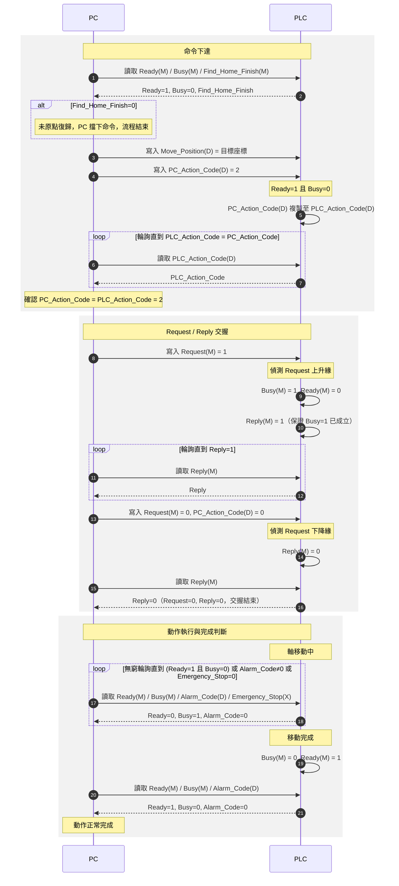
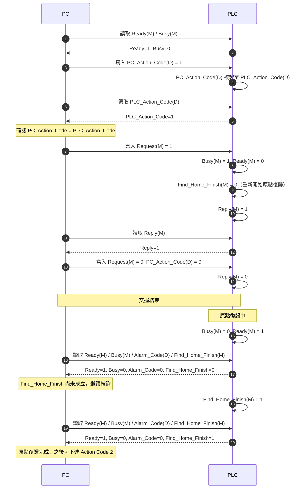
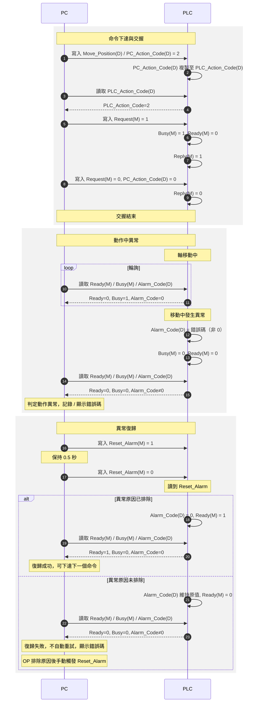
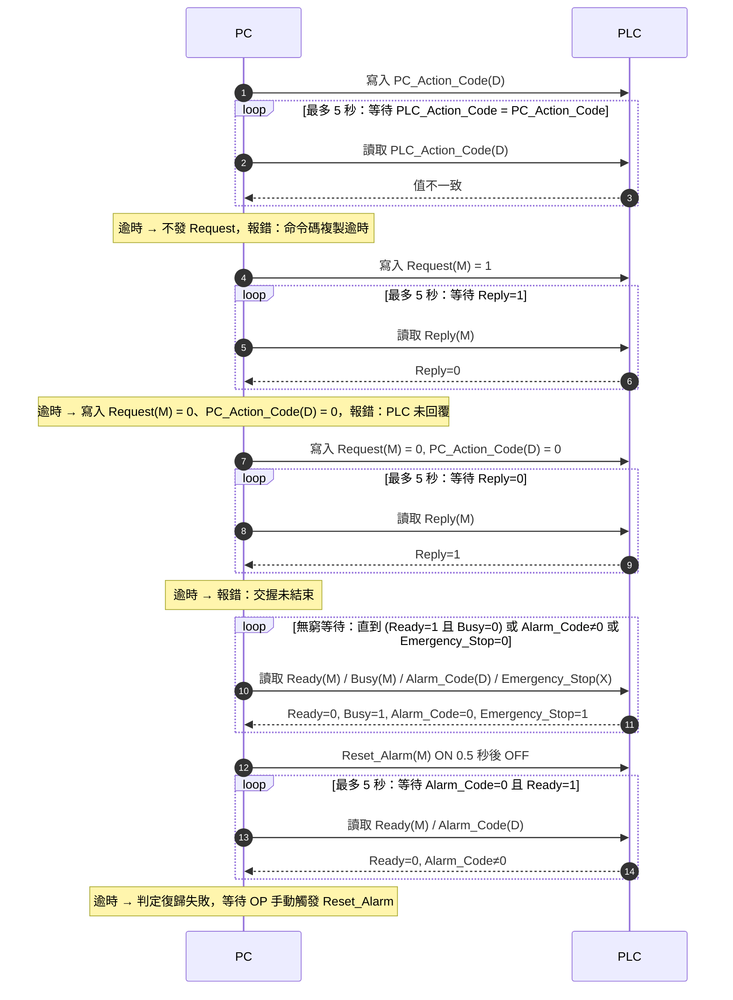
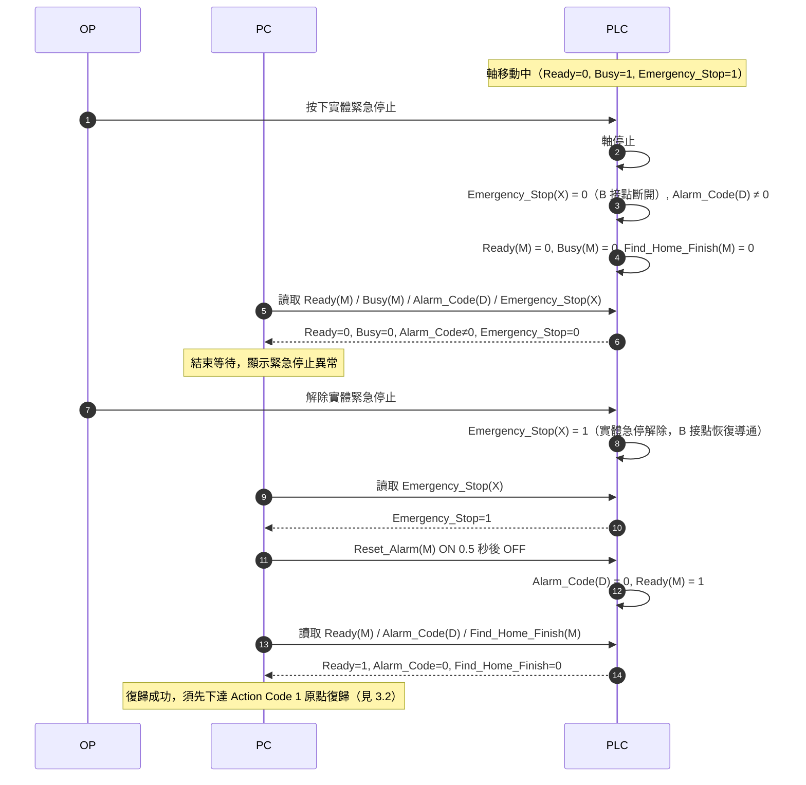
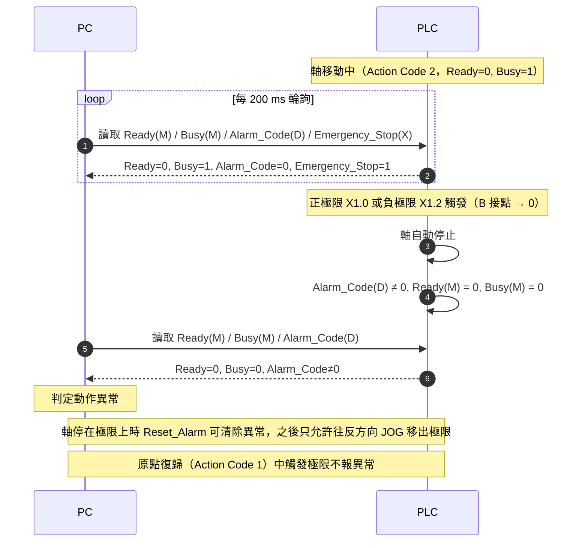
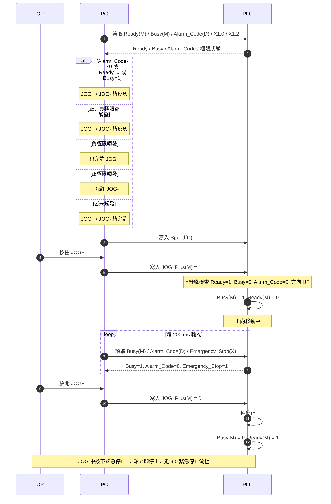
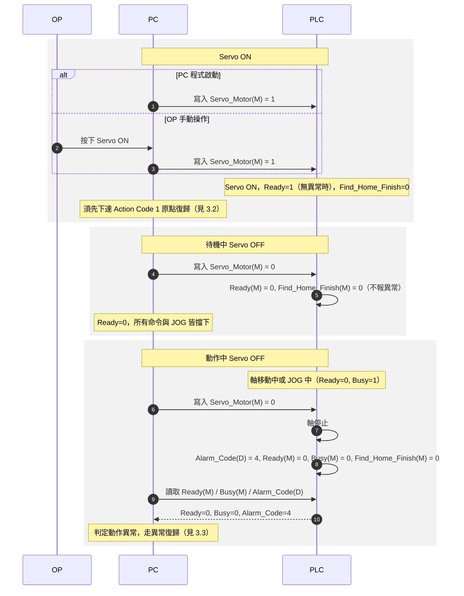

# PLC ↔ PC Modbus 通訊規格

## 1. 位址對照表

- M 為 Coil，X 為 Discrete Input，D 為 Holding Register。
- 本文件只描述單一軸的通訊行為與交握流程；表內位址與 Position 單位以 `PLC Modbus軸控交握.xlsx` 為準，位址為單一軸的範例，各軸依偏移另列。
- Alarm_Code 內容仍為初版，數值未確定。

### 1.1 PLC 寫入至 PC（PC 讀取）

| 英文               | 中文                | PLC 位置   | Modbus 位置 | 型態               |
| ---------------- | ----------------- | -------- | --------- | ---------------- |
| Ready            | 準備好了              | M20 | 20   | Coil             |
| Busy             | 忙碌中               | M21 | 21   | Coil             |
| Find_Home_Finish | 原點復歸完成            | M22 | 22   | Coil             |
| PLC_Action_Code  | 命令碼               | D21 | 21   | Holding Register |
| Reply            | 回覆訊息              | M24 | 24   | Coil             |
| Alarm_Code       | 錯誤碼（非 0 為異常）      | D20 | 20   | Holding Register |
| Current_Position | 目前位置              | DD22 | 22   | Holding Register ×2（I32，佔 D22~D23） |

#### Current_Position 資料格式

- 格式與 `Move_Position` 相同：I32、單位 0.0001 mm（1 mm = 10000），低位在 D22、高位在 D23。
- 換算方式見 1.2 節「Move_Position 資料格式」，將 D121、D122 替換為 D22、D23。

### 1.2 PC 寫入至 PLC

| 英文              | 中文                               | PLC 位置     | Modbus 位置 | 型態                                   |
| --------------- | -------------------------------- | ---------- | --------- | ------------------------------------ |
| Move_Position   | 移動位置（Code 2 為絕對座標，Code 3 為相對距離）  | DD121 | 121  | Holding Register ×2（I32，佔 D121~D122） |
| PC_Action_Code  | 命令碼                              | D120  | 120  | Holding Register                     |
| Request         | 命令觸發                             | M120  | 120  | Coil                                 |
| Reset_Alarm     | 異常復歸                             | M121  | 121  | Coil                                 |
| Servo_Motor     | 伺服馬達（1 = Servo ON，0 = Servo OFF）  | M122  | 122  | Coil                                 |
| JOG_Plus        | 正向寸動                             | M123  | 123  | Coil                                 |
| JOG_Minus       | 負向寸動                             | M124  | 124  | Coil                                 |
| Speed           | 速度 1~100%（絕對、相對移動與 JOG 共用）       | D123  | 123  | Holding Register                     |

#### Move_Position 資料格式

- 型態：I32（有號 32-bit 整數，2 的補數）。絕對座標與相對距離皆可為負值。
- Word 順序：低位在 D121、高位在 D122。
- 單位：0.0001 mm（1 mm = 10000）。PC 端將兩個 Word 組成 I32 後除以 10000 即為 mm。
- 讀取換算：`原始值 = D122 × 65536 + D121`；若 `原始值 ≥ 2147483648`，`數值 = 原始值 − 4294967296`，否則 `數值 = 原始值`；`mm = 數值 / 10000`。
- 範例（正值）：D121 = 16960、D122 = 15 → 1000000 → 100 mm。
- 範例（負值）：D121 = 48576、D122 = 65520 → 4293967296 − 4294967296 = −1000000 → −100 mm。
- 寫入換算：`數值 = mm × 10000`（I32），以 2 的補數拆成兩個 Word，低 16 位元寫 D121、高 16 位元寫 D122。LabVIEW 可用 Split Number 取得高低 Word。

#### Speed 資料格式

- 單位：百分比，範圍 1~100。PC 端只下百分比，實際速度由 PLC 內部換算。
- PC 端寫入前限制在 1~100。

### 1.3 PLC 輸入點（極限、原點與緊急停止）

| 英文 | 中文 | PLC 位置 | Modbus 位置 | 型態 | 接點 |
|---|---|---|---|---|---|
| Positive_Limit | 正極限 | X1.0 | 24592 | Discrete Input | B 接點（正常為 1，觸發為 0） |
| Home_Sensor | 原點 | X1.1 | 24593 | Discrete Input | A 接點（正常為 0，觸發為 1） |
| Negative_Limit | 負極限 | X1.2 | 24594 | Discrete Input | B 接點（正常為 1，觸發為 0） |
| Emergency_Stop | 緊急停止 | X0.0 | 24576 | Discrete Input | B 接點（正常為 1，急停時為 0） |

### 1.4 Action Code 定義

| Action Code | 功能       | 需要 Move_Position | 需要 Find_Home_Finish = 1 |
| ----------- | -------- | ---------------- | ----------------------- |
| 0           | 未定義      | -                | -                       |
| 1           | 軸原點復歸    | 否                | 否                       |
| 2           | 絕對移動 | 是，目標座標           | 是                       |
| 3           | 相對移動（本專案 PLC 不支援） | 是，移動距離（可為負值）     | 是                       |
| 4 ~ 16      | 保留，目前未規劃 | -                | -                       |

- 本專案的 PLC 只支援 Action Code 1、2。相對移動由 PC 端以 `Current_Position` 加上移動距離換算成目標座標，改用 Action Code 2 下達；本文其餘提到 Action Code 3 之處僅適用於支援它的 PLC。

### 1.5 Alarm_Code 定義（初版）

| Alarm_Code | 內容 |
|---|---|
| 0 | 正常 |
| 1 | 緊急停止 |
| 2 | 正極限觸發 |
| 3 | 負極限觸發 |
| 4 | 動作中 Servo OFF |
| 5 ~ 99 | 保留 |

- 初版規劃，數值未確定。
- 2、3 涵蓋三種情況：Action Code 移動中碰到極限、JOG 中碰到極限，以及待機中極限已觸發卻下達朝向該極限的 Action Code 2、3。

## 2. 交握流程說明

Request / Reply 只負責「命令已被 PLC 接收」的交握；動作是否完成由 Ready、Busy、Alarm_Code 判斷。

### 2.0 基本規則

- `Ready = 1` 的條件：Servo ON、沒有異常，且不在動作中（Action Code 動作與 JOG 期間 `Ready = 0`）。
- 未原點復歸時，PLC 本身仍接受 Action Code 2、3；由 PC 端卡控：`Find_Home_Finish = 0` 時，PC 不下達 Action Code 2、3。
- 命令執行中不能停止或中斷。需要中斷時，只能按實體緊急停止。
- `Find_Home_Finish` 在以下情況變回 0：上電、按緊急停止、重新開始原點復歸、Servo OFF。發生異常不一定會讓它變回 0；原點復歸中發生異常時維持 0。
- 原點復歸完成時，PLC 先設 `Busy = 0`，之後才設 `Find_Home_Finish = 1`。
- PC 端等待規則（詳見 3.4 節）：
  - 等待動作完成（軸移動、原點復歸）：不設逾時，無窮等待直到動作完成、`Alarm_Code ≠ 0` 或 `Emergency_Stop = 0`（按下緊急停止）。
  - 其他等待（命令碼複製、Request / Reply 交握、異常復歸）：逾時 5 秒。
- PC 端輪詢週期預設 200 ms。

### 2.0.1 極限保護

- 軸移動中觸發正極限（X1.0）或負極限（X1.2）時，PLC 自動停止軸並報異常：`Alarm_Code ≠ 0`、`Ready = 0`、`Busy = 0`。
- 例外：原點復歸（Action Code 1）過程中觸發極限不報異常。
- 軸停在極限上時，`Reset_Alarm` 可清除極限異常（`Alarm_Code = 0`、`Ready = 1`），之後等同「待機中極限已觸發」，只允許往反方向 JOG 移出極限。
  - 例：負極限觸發並報異常 → OP 按 `Reset_Alarm` → 異常清除 → 按 JOG+ 移出負極限。
- 待機中（尚未下達動作）極限已觸發：不報異常，`Ready` 維持 1，可依 2.0.2 的方向限制 JOG。
- 待機中極限已觸發時，若下達 Action Code 2、3，且移動方向朝向已觸發的極限，PLC 不移動，直接報異常。

### 2.0.2 JOG（寸動）

- 由 PC 端操作，透過 `JOG_Plus`（M123）、`JOG_Minus`（M124）兩個 Coil 觸發。
- 操作方式（初版）：OP 按住 PC 畫面上的 JOG 按鈕時，PC 寫入 1；放開時寫入 0。PLC 在 1 期間持續移動，變 0 時停止。
- 速度由 `Speed`（D123）決定，與絕對、相對移動共用。PC 在按下 JOG 前寫入。
- 允許 JOG 的條件：`Ready = 1`、`Busy = 0`、`Alarm_Code = 0`。有異常時不能 JOG。PLC 只在 JOG 訊號上升緣檢查條件。
- 不需要 `Find_Home_Finish = 1`。
- JOG 期間的狀態：比照 Action Code 動作，`Busy = 1`、`Ready = 0`；放開停止後回到 `Busy = 0`、`Ready = 1`。
  - PC 下達 Action Code 前會檢查 `Ready = 1`、`Busy = 0`，JOG 中自然被擋下，不必另外判斷 JOG 狀態。
  - 另一方向的 JOG 同樣被擋下，須先放開目前的 JOG、軸停止後才能換方向。
  - 「軸在動 ⇔ Busy = 1」對所有動作一致，PC 畫面顯示與卡控只看 Busy 即可。
- 通訊中斷保護：不另外設計。JOG 中若 PC 與 PLC 通訊中斷，由 OP 按緊急停止讓 JOG 停止。
- 極限方向限制：

| 正極限 X1.0 | 負極限 X1.2 | JOG+ | JOG- |
|---|---|---|---|
| 未觸發 | 未觸發 | 有效 | 有效 |
| 未觸發 | 觸發 | 有效 | 無效 |
| 觸發 | 未觸發 | 無效 | 有效 |
| 觸發 | 觸發 | 無效 | 無效 |

- 方向限制由 PLC 執行；PC 端讀取 X1.0、X1.2 後同步將無效方向的按鈕反灰。
- JOG 中觸發極限：PLC 立即停止並報異常（`Alarm_Code` = 2 或 3、`Ready = 0`、`Busy = 0`）。例：從負極限按 JOG+ 移出後一路移動到觸發正極限，PLC 直接跳異常。

### 2.0.3 緊急停止

- `Emergency_Stop` 為 B 接點：正常時為 1，按下緊急停止時為 0。
- 按下緊急停止後：`Emergency_Stop = 0`、`Ready = 0`、`Busy = 0`、`Alarm_Code ≠ 0`、`Find_Home_Finish = 0`。
- 實體急停解除後，`Emergency_Stop` 自動回到 1，不需等 `Reset_Alarm`。
- `Alarm_Code` 與 `Ready` 仍需走 2.4 節的 `Reset_Alarm` 流程復歸。
- 因 `Find_Home_Finish = 0`，復歸後須先做原點復歸（Action Code 1），才能下達 Action Code 2、3。

### 2.0.4 伺服馬達（Servo_Motor）

- `Servo_Motor` 由 PC 寫入：1 = Servo ON，0 = Servo OFF。
- Servo ON 時機：PC 程式啟動時自動寫入 1，或由 OP 在 PC 畫面上手動操作。
- Servo OFF 時 `Ready` 一定為 0；Servo ON 且無異常、不在動作中時 `Ready` 才會為 1。PC 只看 `Ready` 即可擋下所有命令與 JOG。
- 待機中 Servo OFF：`Ready = 0`，不報異常（`Alarm_Code` 維持 0）。
- Servo OFF 時 `Find_Home_Finish` 變回 0，重新 Servo ON 後須先做原點復歸（Action Code 1），才能下達 Action Code 2、3。
- 動作中或 JOG 中寫入 Servo OFF：PLC 停止軸並報異常（`Alarm_Code = 4`、`Ready = 0`、`Busy = 0`），之後走 2.4 節 `Reset_Alarm` 流程復歸。

### 2.1 命令下達

1. PC 讀取 `Ready = 1`、`Busy = 0`，確認 PLC 可接受命令。下達 Action Code 2、3 時，另需 `Find_Home_Finish = 1`，否則 PC 擋下命令。
2. PC 寫入 `Move_Position` 與 `Speed`（僅 Action Code 2、3 需要；Code 2 為目標座標，Code 3 為移動距離）。
3. PC 寫入 `PC_Action_Code`。
4. PLC 在 `Ready = 1` 且 `Busy = 0` 時，將 `PC_Action_Code` 的值複製至 `PLC_Action_Code`；動作執行中不複製，`PLC_Action_Code` 維持執行中的命令碼。
5. PC 讀取 `PLC_Action_Code`，確認 `PC_Action_Code = PLC_Action_Code` 後才發 Request。
   - PC 每次把 `Request` 寫回 0 時，一併把 `PC_Action_Code` 寫為 0（見第 9 步）。動作結束、PLC 回到待機後會把 0 複製到 `PLC_Action_Code`，下一個命令即使碼相同，第 5 步的比對也能確認 PLC 收到的是新命令。

### 2.2 Request / Reply 交握

6. PC 將 `Request` 設為 1。
7. PLC 偵測到 `Request` 上升緣，設 `Busy = 1`、`Ready = 0`。
8. PLC 設 `Reply = 1`。PLC 保證 PC 讀到 `Reply = 1` 時，`Busy = 1` 已成立。
9. PC 偵測到 `Reply = 1`，將 `Request` 清為 0，並將 `PC_Action_Code` 寫為 0。此時 PLC 動作中不複製，`PLC_Action_Code` 維持執行中的命令碼。
10. PLC 偵測到 `Request = 0`，將 `Reply` 清為 0。此時 `Request = 0`、`Reply = 0`，交握結束。

### 2.3 動作執行與完成判斷

11. 交握結束後，PLC 才開始執行動作（軸移動 / 原點復歸）。
12. 動作結束時，PLC 依結果設定狀態：
    - 正常完成：`Busy = 0`、`Ready = 1`，`Alarm_Code = 0`。
    - 動作中異常：`Alarm_Code` 寫入錯誤碼（一定非 0），`Busy = 0`、`Ready = 0`。
13. PC 輪詢 `Ready`、`Busy`、`Alarm_Code` 判斷結果：

| Ready | Busy | Alarm_Code | 判定 |
|---|---|---|---|
| 0 | 1 | 0 | 動作執行中，繼續輪詢 |
| 1 | 0 | 0 | 動作正常完成 |
| 0 | 0 | ≠ 0 | 動作異常，進入異常復歸 |

原點復歸（Action Code 1）因 `Busy = 0` 先於 `Find_Home_Finish = 1` 成立，完成條件需再加上 `Find_Home_Finish = 1`：讀到 `Ready = 1`、`Busy = 0` 但 `Find_Home_Finish = 0` 時，PC 繼續輪詢，不可判定完成。

### 2.4 異常復歸

動作中與待機時發生的異常都走同一套流程：`Alarm_Code ≠ 0`、`Ready = 0`，由 PC 觸發 `Reset_Alarm`。

14. PC 讀到 `Alarm_Code ≠ 0` 時，將 `Reset_Alarm` 設為 1。
15. 0.5 秒後，PC 將 `Reset_Alarm` 清為 0。
16. PLC 讀到 `Reset_Alarm` 後，依異常原因是否排除設定狀態：
    - 已排除：`Alarm_Code` 清為 0，`Ready = 1`。
    - 未排除：`Alarm_Code` 維持原值，`Ready = 0`。（極限異常例外：軸停在極限上仍可清除，見 2.0.1）
17. PC 輪詢判斷復歸結果：
    - `Alarm_Code = 0`、`Ready = 1`、`Busy = 0`：復歸成功，可下達下一個命令。
    - `Alarm_Code` 維持非 0、`Ready = 0`：復歸失敗。PC 不自動重試，顯示錯誤碼，由 OP 排除原因後手動觸發 `Reset_Alarm`（回到第 14 步）。

## 3. 時序圖

### 3.1 線性軸移動至目標座標（Action Code 2）— 正常流程

相對移動（Action Code 3）流程相同，只是 `PC_Action_Code = 3`，`Move_Position` 寫入移動距離。本專案 PLC 不支援 Code 3，PC 端換算成目標座標後走本流程（見 1.4 節）。

### 3.2 軸原點復歸（Action Code 1）

### 3.3 異常流程與異常復歸

### 3.4 PC 端等待條件與逾時

只有等待動作完成為無窮等待，其他等待點逾時皆為 5 秒。

| 等待點 | 正常結束 | 異常結束 | 逾時 | 逾時處理 |
|---|---|---|---|---|
| 命令碼複製 | `PLC_Action_Code = PC_Action_Code` | `Alarm_Code ≠ 0` 或 `Emergency_Stop = 0` | 5 秒 | 不發 Request，報錯：命令碼複製逾時 |
| 等待 Reply = 1 | `Reply = 1` | `Alarm_Code ≠ 0` 或 `Emergency_Stop = 0` | 5 秒 | 寫入 `Request = 0`、`PC_Action_Code = 0`，報錯：PLC 未回覆 |
| 等待 Reply = 0 | `Reply = 0` | `Alarm_Code ≠ 0` 或 `Emergency_Stop = 0` | 5 秒 | 報錯：交握未結束 |
| 軸移動（Action Code 2） | `Ready = 1`、`Busy = 0` | `Alarm_Code ≠ 0` 或 `Emergency_Stop = 0` | 無（無窮等待） | - |
| 原點復歸（Action Code 1） | `Ready = 1`、`Busy = 0`、`Find_Home_Finish = 1` | `Alarm_Code ≠ 0` 或 `Emergency_Stop = 0` | 無（無窮等待） | - |
| 異常復歸 | `Alarm_Code = 0`、`Ready = 1` | - | 5 秒（自 `Reset_Alarm` OFF 起算） | 判定復歸失敗，顯示錯誤碼，由 OP 手動重新觸發 |

### 3.5 緊急停止

### 3.6 極限觸發

### 3.7 JOG（寸動）

### 3.8 伺服馬達 ON / OFF

