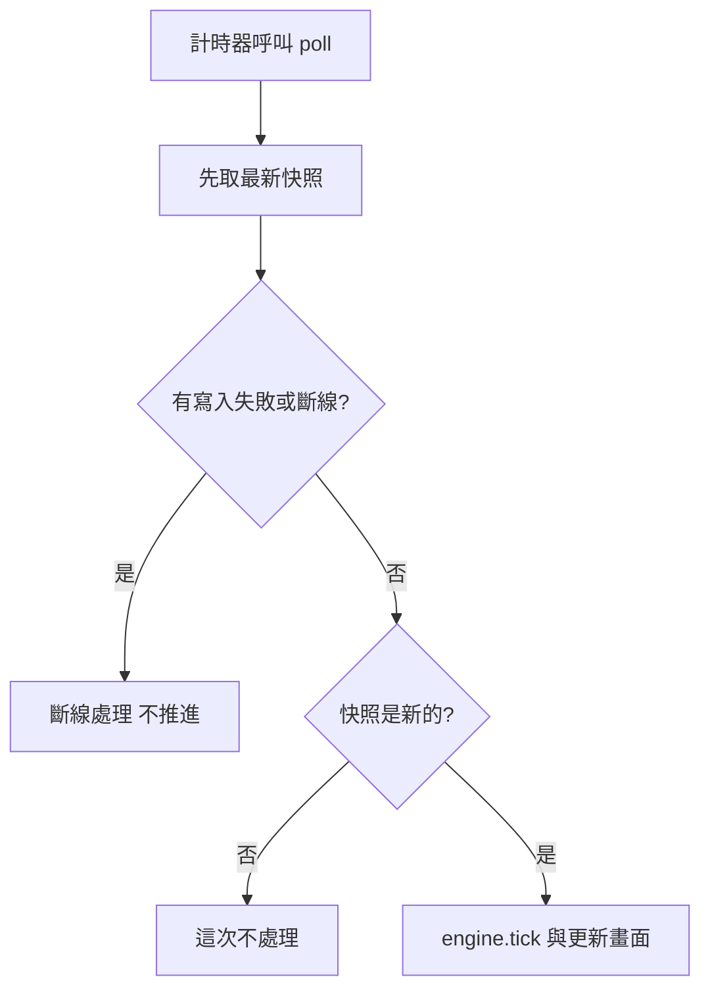
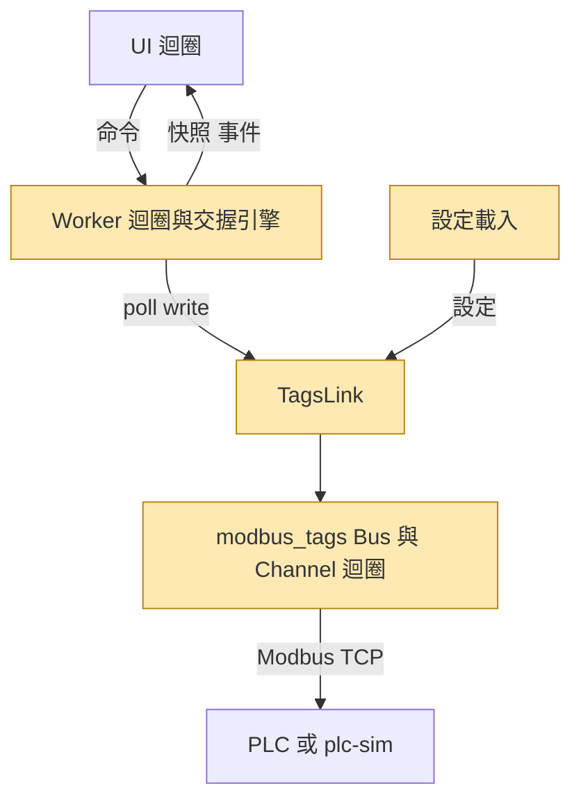

# plc-motion 通訊層改用 modbus_tags Design

> 當 plan / implementation 對 spec 的原意有疑義時，這份 design 檔就是原始理由的唯一真理來源。

## Context

- `app/` 的通訊層是自寫的 `ModbusLink`（`src/plc_motion/plc/modbus_link.py`），由 `PlcWorker` 在 Worker 執行緒同步讀寫。
- 使用者把基底函式庫 `modbus_tags` 0.6.0 複製到 `app/src/lib/modbus_tags`，內容與基底 `AI Project\Python Library\modbus-tags\src\modbus_tags` 相同，要 app 改用它。
- 交握引擎與設定載入目前都不依賴 Qt：`engine/`、`plc/`、`settings/`、`codec.py` 沒有匯入 PySide6。Qt 只在 `worker.py`、`app.py`、`ui/` 與 `sim/` 的視窗。
- 沒有實機 PLC，驗證都對 `plc-sim` 跑。目前沒有現場部署。

## Problem Statement

`modbus_tags` 與現有通訊層的差異不只 API：

| 面向 | 現有程式 | modbus_tags 0.6.0 | 依據 |
|---|---|---|---|
| 執行緒 | Worker 自己讀寫 | 每條通道一條 Thread 輪詢 | `lib/modbus_tags/channel.py` |
| 寫入 | 同步，下一個事件就寫 | 排入佇列，下一輪開始才送 | `channel.py:240` 的等待不看佇列 |
| 寫入被 PLC 拒絕 | 例外，立刻視為通訊中斷 | 只有該筆失敗，連線保留 | `channel.py:365` |
| 重連 | 手動 | 可設定，預設自動 | `config/device.py` |
| 輪詢事件 | 每輪都 tick | `on_change` 只在值變動時觸發 | `channel.py` 的 `_round` |
| 接點 | 程式依 `ON` 判斷 B 接點 | 讀值時套用 `invert`，只給邏輯值 | `datatypes.py` 的 `_bool_decode` |
| 設定 | `config/` 平放，含 `[handshake]`、`[log]` | `config/modbus/<通道>/`，未知鍵報錯 | `config/device.py` |

其中會直接造成風險的是寫入時序：`interval_ms = 200` 時，JOG 放開最多晚約 200 ms 才送出。以軸速 50 mm/s 計算約多走 10 mm（依程式碼推算，尚未量測）。

## Approaches Considered

### Approach A：新增 adapter 取代 ModbusLink，引擎不動（採用）

`PlcPort` 留下，新增 `TagsLink` 包住 `Bus`。引擎、交握和 UI 版面都不動，差異集中在 adapter、worker 與設定載入。

Pros：
- 交握是規格書定義的安全相關流程，既有測試可以原封不動驗證它。
- 引擎本來就只透過 `PlcPort.write` 碰 PLC，這條 seam 兩側已有兩個 adapter（正式、`ModelPort`）。

Cons：
- 引擎的同步寫入假設要由 adapter 和 worker 補回來（見「執行流程」）。

### Approach B：引擎改為事件驅動（否決）

用 `on_change`、`on_write_done` 直接驅動引擎。

否決原因：引擎和交握都要重寫，又要重新驗證；交握逾時每輪都要判斷，`on_change` 只在值變動時才觸發，仍需要計時器。

### 喚醒機制的替代方案（否決）

| 方案 | 否決原因 |
|---|---|
| 縮短輪詢週期 | PLC 負載增加，延遲仍存在 |
| 接受最多約 200 ms 延遲 | JOG 可能多走，屬安全面退步 |
| 改寫成 `Dequeue(-1)` ＋ Polling Event 計時器 | 要重寫通道迴圈並重驗輪詢時序。有 timeout 的等待已有相同的 JOG 即時性，且輪詢事件不會堆積 |

### JOG 寫入失敗的替代方案（否決）

JOG 每筆寫入都等結果：`Speed` 被拒絕時 `JOG = 1` 不會送出，但按下 JOG 要多等一輪讀取，也要處理等待逾時。

## Recommendation

採 Approach A，並在基底加上「有寫入就立刻喚醒」。

犧牲的東西：

- 批次讀取失敗時不再逐點定位 Tag，訊息只有範圍。讀取範圍由使用者自訂，訊息已能指出要查哪一段。
- 函式庫回報的設定與通訊錯誤是英文。
- 停止 Bus 最多要等「請求逾時 + 2 秒」；這段時間 Worker 暫停，UI 不受影響。

### 基底 0.7.0：有寫入就立刻喚醒

這個問題每個專案都會遇到，所以改基底，不改副本。依據：使用者的原則是適用所有專案的改基底，只跟專案有關的才改副本。

等待概念等同 `Dequeue(剩餘時間)`：有寫入就立刻處理，timeout 就輪詢。

| 情況 | 行為 |
|---|---|
| 等待時有寫入 | 立刻開始新的一輪：先寫入，再讀取 |
| 一輪結束時佇列已有寫入 | 不等待，立刻開始下一輪 |
| 下一輪時間 | 從這一輪開始重新算 `interval_ms` |
| 持續高速寫入 | 每一輪仍會讀取 |
| 沒有寫入 | 週期不變 |
| 正在停止 | 不因喚醒多送請求 |

### 設定檔

```text
config/
├─ app.toml            [handshake]、[log]
├─ axes.toml
├─ positions.csv
└─ modbus/Channel01/
   ├─ device.toml      連線、逾時、輪詢
   ├─ io_points.csv
   └─ read_ranges.toml
```

- `[handshake]`、`[log]` 不能留在通道的 `device.toml`：函式庫對未知鍵報錯。
- 只允許 `Channel01`：函式庫會輪詢所有啟用的通道，多出來的通道沒有人使用。
- 啟動檢查分兩層：函式庫管檔案格式、位址、讀取範圍；app 管必要 Tag、型別、同軸倍率、位址重疊、整數倍率。
- 倍率要是整數：app 的小數位數由倍率字串長度換算（`codec.decimals_for`），函式庫則給 float。
- 必要 Tag 的 `invert=true` 只允許用於極限、原點、急停這四種感測點；非必要點依函式庫規則，可以使用。
- 必要 Tag 維持固定型態與屬性，非必要點可用函式庫支援的全部型別與 Data Model（見「審查後修訂」）。
- 取消「極限必須是 B 接點」：現場才知道接點型式，只改設定檔就要能換。
- `--host`／`--port` 用 `modbus_tags.config.load_config` 載入後替換位址，再建立 `Bus`，不必改函式庫。

### 執行流程

Worker 以短週期計時器呼叫 `TagsLink` 檢查連線狀態、新快照與寫入失敗，只有這一條路徑。不用 Qt signal 從 Channel 迴圈回傳：這樣舊 Bus 不會留下待處理事件，也符合「`TagsLink` 不依賴 Qt」。



快照可能比寫入早一輪：寫入時 Channel 可能正好在讀取。逐一檢查交握等待點：`Reply`、`Busy`、`PLC Action Code` 都要等 PLC 反應才會變，舊值只會讓引擎多等一輪，不會誤判前進。這個結論用帶通訊延遲的測試確認。

### 失敗處理

| 事件 | 處理 |
|---|---|
| 連線中斷或讀取失敗 | 停止 Bus、`engine.on_disconnected()`，等手動重連 |
| 寫入被 PLC 拒絕 | 先盡力對按住中的 JOG 點寫 0，再走上面的流程 |
| JOG 寫 0 也失敗 | 記錄日誌，沿用「軸可能仍在移動，請按急停」的提示 |
| 排在失敗寫入之後的寫入 | 可能仍會送出；`Request` 要等下一步才寫，引擎會先看到失敗 |

- 寫入被拒絕仍視為中斷，維持主規格 FR-13 的行為。
- 為什麼要先寫 0：佇列裡 `Speed` 被拒絕後，`JOG = 1` 可能已經送出；直接斷線會讓軸一直動，放開按鈕也寫不到。
- 時序保證：失敗的寫入在同一輪的快照更新前就記錄（`channel.py` 的 `_round` 先寫入、後讀取）。`poll` 先取快照、再查失敗，所以拿到的快照若屬於失敗那一輪，一定也看得到失敗。
- 每次重連都建新 Bus，不用 `bus.reconnect()`：停止的 Bus 不能再啟動，流程也只有一條。
- 重連一律由操作員觸發：預設設定寫 `auto_reconnect = false`，app 建立 Bus 時也強制為 false，不受設定檔影響。
- 停止 Bus 之前，已排入的寫入要先有結果或逾時，JOG 放開才不會被丟棄。
- JOG 寫 0 成功後仍提示「軸可能仍在移動，請按急停」：PLC 接受寫入不代表軸已停止，斷線後也無法再確認。

### A 接點與顯示

| 用途 | 使用的值 |
|---|---|
| 交握、前置檢查、軸控頁狀態 | 邏輯值 |
| IO Monitor 燈號 | PLC 原始值（由 `invert` 還原） |
| `plc-sim` 行為模型 | 原始值，它模擬實體訊號 |

`ModelPort` 做同樣換算，讓引擎測試與正式環境看到相同的值。

### plc-sim 與相依

- 保留 `SimServer` 與 `PlcModel`：函式庫的 `Simulator` 只模擬記憶體，沒有軸運動和交握。
- 匯入路徑用 `lib.modbus_tags`。已實測：`uv_build` 設 `module-name = ["<app>", "lib.<pkg>"]` 可匯入，wheel 也包含；PyInstaller `--paths src` 打包的 exe 可匯入。
- 現在鎖定 pymodbus 3.16.1，函式庫要求 `>=3.16.2,<3.17`，實作時要確認 `SimServer` 在新版正常。

### 後續：抽成軸控 library（不在本次範圍）

使用者之後要把交握等業務邏輯抽成不含畫面的 Python library，像 `modbus_tags` 一樣搬到別處使用。分兩步：本次先完成遷移，並保留拆分條件；實際抽出另開一輪。

原因：同時改通訊層和 library 邊界，出問題時難以判斷原因；交握尚未上過實機，太早定 API 之後可能要改；最大的工作是取代 `worker.py` 的 Qt 迴圈，值得獨立設計。

本次保留的條件：`TagsLink`、`Snapshot`、設定載入與引擎不依賴 Qt，並以測試禁止它們匯入 PySide6。

預計的分層：應用程式與畫面 → 軸控 library → `modbus_tags` → PLC。

## 審查後修訂（2026-11-07）

spec 第 1 輪複審發現 design 補回同步寫入假設的地方有漏洞。`docs/cdr/` 不存在，修訂紀錄依協議寫在這裡。

| 修訂 | 原本 | 改成 | 原因 |
|---|---|---|---|
| 喚醒範圍 | 只涵蓋等待時 | 一輪結束時佇列有寫入也立刻開始下一輪 | 讀取途中放開 JOG 仍可能多等一整個週期 |
| 停止前的寫入 | 排入後直接停 Bus | 停止前等已排入的寫入有結果或逾時 | 舊版同步寫完才停；新版 `app.py` 結束流程的 JOG = 0 會被丟棄，軸持續移動 |
| 自動重連 | 靠發現斷線後停 Bus | 建立 Bus 時強制 `auto_reconnect = false` | 短重連間隔可能在兩次檢查之間重連成功，跳過殘留交握與 JOG 殘留檢查 |
| 檢查順序 | 先查失敗、再查快照 | 先取快照、再查失敗 | 兩步之間通道可能完成一輪，引擎會用失敗那一輪的快照推進 |

使用者另外決定：

- 非必要點支援函式庫的全部型別與 Data Model：`Bool`（含暫存器位元）、`U16`、`I16`、`U32`、`I32`、`F32`、`String`，以及 Input Register。IO Monitor 與 `plc-sim` 一起擴充。否決「啟動時報錯」：使用者要讓 app 能用到函式庫的能力。
- 因此 `invert=true` 可能出現在可寫的非必要點，IO Monitor 手動寫入要換算。
- 必要 Tag 維持固定型態，防止 `word_order=high_first` 或 `Speed` 帶 `scale` 這類設定影響交握。
- `(B)` 只在 `invert=true` 時顯示；軸控頁的正負極限與原點感測器燈號也新增這個標示。現有軸控頁沒有 `(B)`，這是使用者確認後的新增，不只是改條件。

## Non-Goals 與 Hard Constraints

Non-Goals（刻意不做）：
- 不支援多台 PLC 或 RTU
- 不開啟自動重連
- 不用函式庫的 `Simulator` 取代 `plc-sim`
- 不自動轉換舊版設定檔，只轉換 repo 內的預設設定
- 不翻譯函式庫的英文錯誤訊息
- 不恢復批次讀取失敗後逐點定位 Tag
- 不改交握流程與 PLC 通訊規格
- 不改 UI 版面，只改 B 接點燈號的資料來源、IO Monitor 的 `(B)` 標示條件、軸控頁新增 `(B)` 標示、IO Monitor 的分頁文字與多型別顯示和寫入
- 不把 app 改成事件驅動
- 不在本次抽出軸控 library

Hard Constraints（絕對不能動）：
- 交握寫入順序：`Target Position`、`Speed` → `PC Action Code` → `Request`
- 位址、倍率與資料格式以 xlsx 與 `七軸_Modbus位址表.md` 為準，I32 低位在前
- 程式判斷一律用 A 接點邏輯值，接點型式只由 `invert=true` 決定
- IO Monitor 顯示 PLC 原始值
- 斷線後不補寫，重新連線後維持殘留交握檢查，以及 JOG 殘留立即寫 0
- 只用可商用的套件（PySide6、pymodbus、pyserial），維持 onedir 打包
- 基底只能相依 pymodbus，不能依賴 PySide6；副本內不留基底以外的未記錄修改

Avoidances（偏好但可協商）：
- 交握引擎和 UI 盡量不動
- 只使用函式庫的公開介面，例外是 `modbus_tags.config.load_config` 與 `modbus_tags.datatypes` 的編解碼
- 不為這次遷移順便重構無關的程式

Past Gotchas：無（專案沒有 `docs/gotchas/`）

## Blueprint Delta

藍圖連結：[[design-system-blueprint]]



| 變更 | 項目 |
|---|---|
| 新增 | `TagsLink`、`lib.modbus_tags` |
| 移除 | `ModbusLink`、`plc/batching.py`、`settings/read_ranges.py` |
| 改向 | 交握引擎與 Worker 不再同步讀寫 PLC，Channel 迴圈負責通訊 |
| 修改 | `worker.py`、設定載入、`Snapshot`、IO Monitor、`plc-sim` 的設定來源與多型別支援 |
