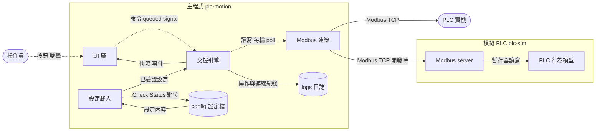

# 七軸 Modbus Master 系統藍圖

> 長生命文件：approved 後就地增量更新＋文內變更紀錄，不走 superseded 換檔（結構性大翻案除外）。

## 一分鐘導覽

- UI：主視窗（左側導覽、軸控頁、IO Monitor）、系統匣、主題；只送命令、收快照，不碰 Modbus。
- 交握引擎：在背景執行緒每輪依 PLC 快照推進七軸狀態機，負責多軸命令、全域動作鎖、前置檢查與逾時。
- PLC 讀寫介面：交握引擎與 PLC 之間的 seam；正式接 Modbus 連線，單元測試接 PLC 行為模型。
- Modbus 連線：包裝 pymodbus client，依 read_ranges.toml 的範圍批次讀取；沒有該檔時依點位表自動合併連續位址。
- 設定載入：讀五個設定檔（read_ranges.toml 可省略）並做啟動檢查，產出唯讀設定給引擎與 UI；Check Status 與點位資料由它寫回。
- 模擬 PLC：獨立程式，pymodbus server 包住 PLC 行為模型，讀同一份 io_points 與 read_ranges（範圍內的空號位址讀到 0）。
- UI → 交握引擎：命令經佇列送進背景執行緒；JOG 放開插隊立即寫 0。
- 交握引擎 → UI：每輪送出快照與操作事件（Qt signal）。

## 系統方塊圖

單元測試時，交握引擎改接 PLC 行為模型（不經 TCP），圖上不另畫。

## 方塊職責表

| 方塊 | 職責（一句話） | 對應程式位置 | 擁有的狀態 |
|---|---|---|---|
| UI 層 | 顯示快照、把操作轉成命令、系統匣與主題 | | 選定軸、導覽收合、篩選條件 |
| 交握引擎 | 依規格書交握、多軸操作、全域鎖、前置檢查 | | 各軸狀態機、進行中的操作 |
| Modbus 連線 | 批次讀取與單點寫入、連線管理 | | TCP 連線 |
| 設定載入 | 讀檔、編碼處理、啟動檢查、寫回 | | 設定物件 |
| Modbus server | 把 TCP 請求轉成行為模型的讀寫 | | 無 |
| PLC 行為模型 | 照規格書模擬 PLC 與軸運動 | | 各軸模擬狀態、注入的故障 |

## 介面與資料契約表

| 邊（from → to） | 傳遞內容 | 同步/非同步 | 觸發時機 |
|---|---|---|---|
| UI → 交握引擎 | 操作命令 | 非同步（佇列） | 使用者操作 |
| 交握引擎 → UI | 快照、操作開始／結果、連線狀態 | 非同步（signal） | 每輪輪詢、事件發生時 |
| 交握引擎 → PLC 讀寫介面 | 讀全部點、寫單點 | 同步（背景執行緒內） | 每輪輪詢、狀態機推進 |
| 設定載入 → 交握引擎、UI | 已驗證設定 | 同步 | 啟動時一次 |

## 暫存與狀態表

| 資料項 | 存放處 | 生命週期 | 誰寫 | 誰讀 | 重用方式 |
|---|---|---|---|---|---|
| PLC 快照 | 記憶體 | 每輪覆蓋 | 交握引擎 | UI | 只用最新一份 |
| Check Status | io_points.csv | 長期 | UI 經設定載入 | IO Monitor | 下次點檢前可整批重設 |
| 點位資料 | positions.csv | 長期 | UI 經設定載入 | 軸控頁 | 匯入／匯出 |
| 主題選擇 | device.toml | 長期 | UI | UI | 啟動時套用 |
| 日誌 | logs\ 每日一檔 | 保留天數由設定決定 | 交握引擎、UI | 人 | 追查問題 |

## 變更紀錄

| 日期 | 觸發來源 | 摘要 |
|---|---|---|
| 2026-10-31 | 初版定稿（[[design-modbus-master-app]]） | 建立主程式與模擬 PLC 的方塊結構 |
| 2026-11-02 | spec FR-61、FR-62 | 新增 read_ranges.toml：使用者指定批次讀取範圍，主程式與模擬 PLC 共用 |
